# Dotfiles - Hyprland on Fedora

Dotfiles managed with GNU Stow, optimized for Hyprland on Fedora.

## Preview

<table>
  <tr>
    <td>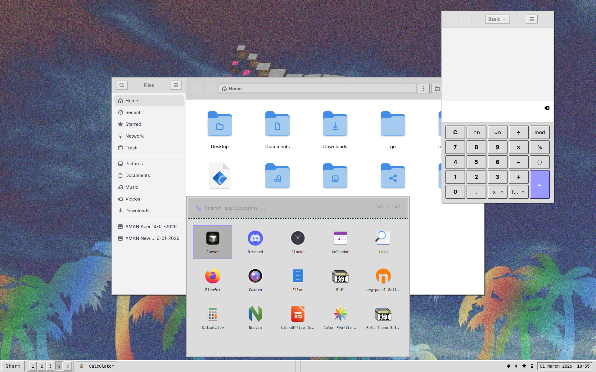</td>
    <td>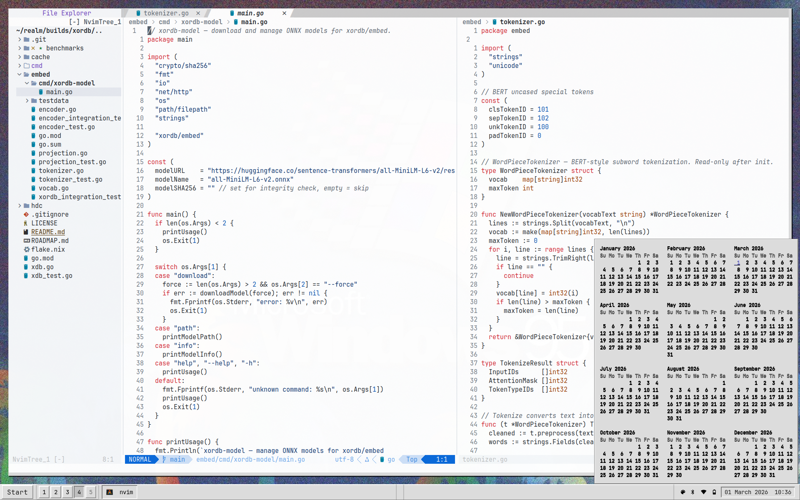</td>
    <td>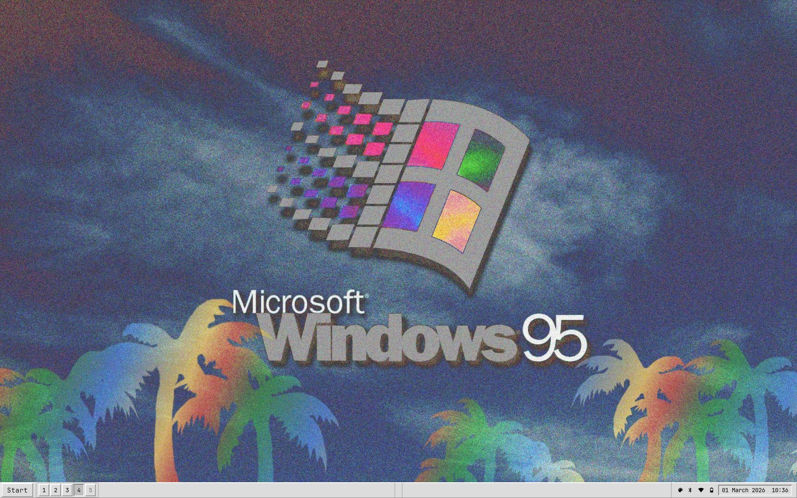</td>
  </tr>
  <tr>
    <td>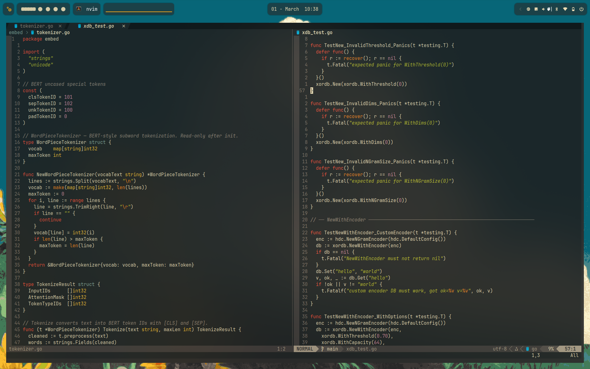</td>
    <td>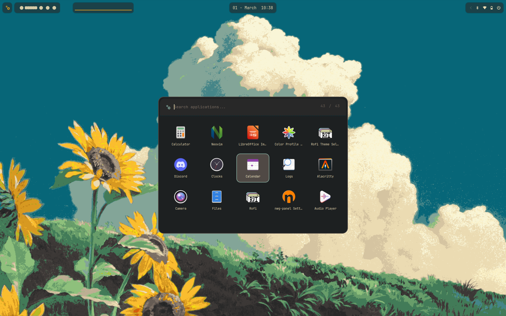</td>
    <td>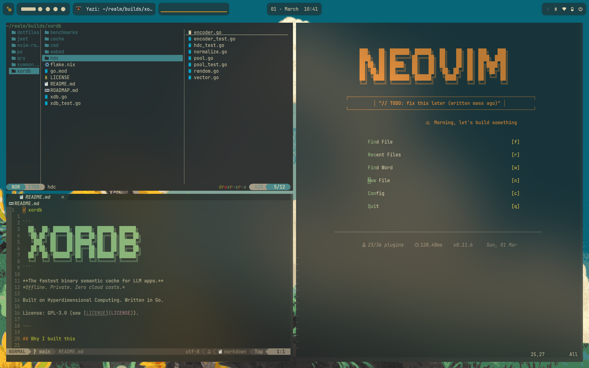</td>
  </tr>
  <tr>
    <td>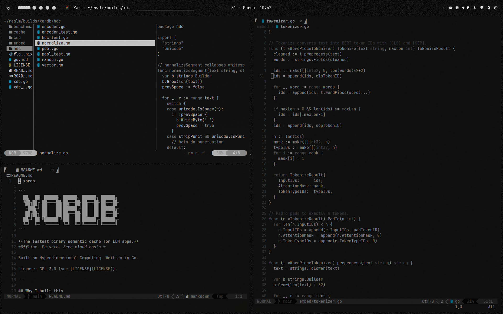</td>
    <td>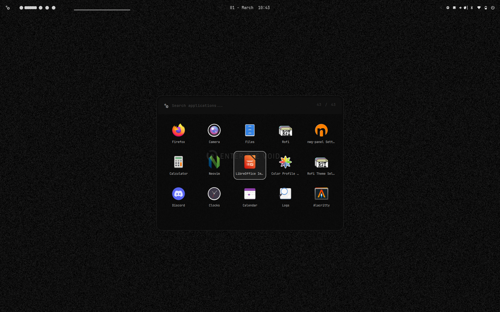</td>
    <td>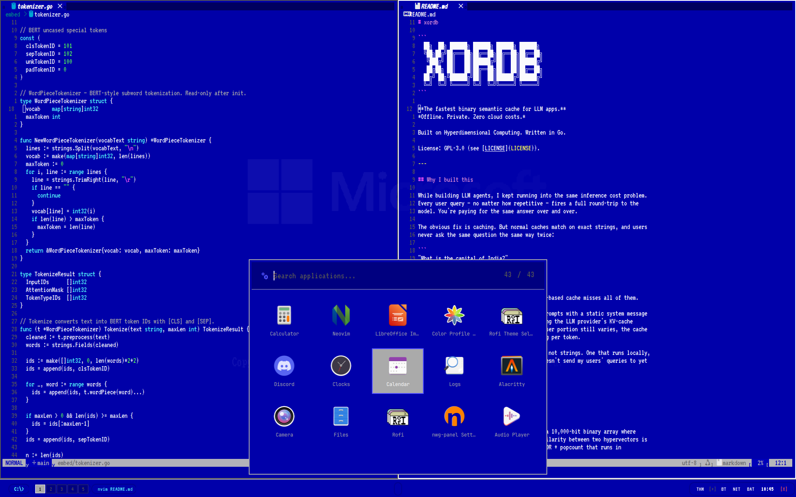</td>
  </tr>
  <tr>
    <td>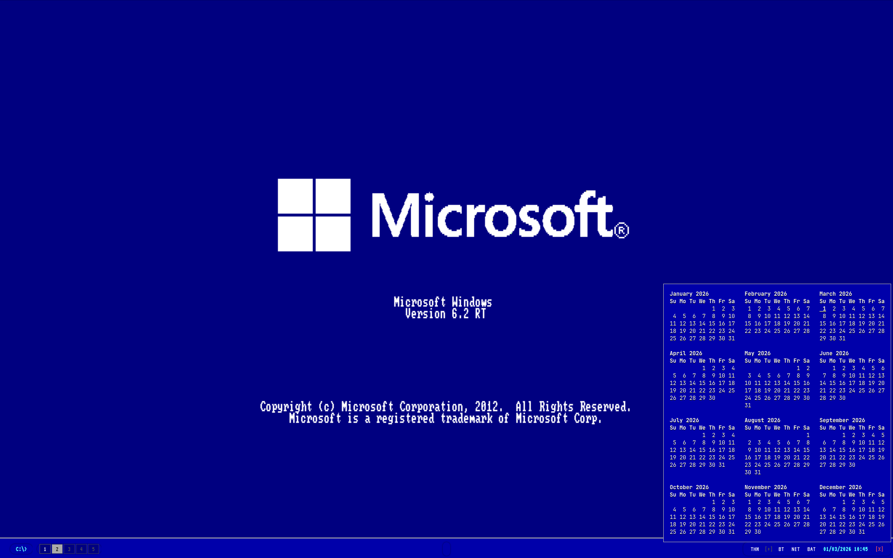</td>
    <td>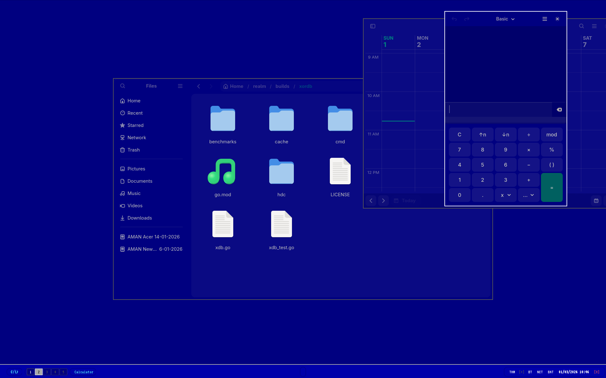</td>
    <td>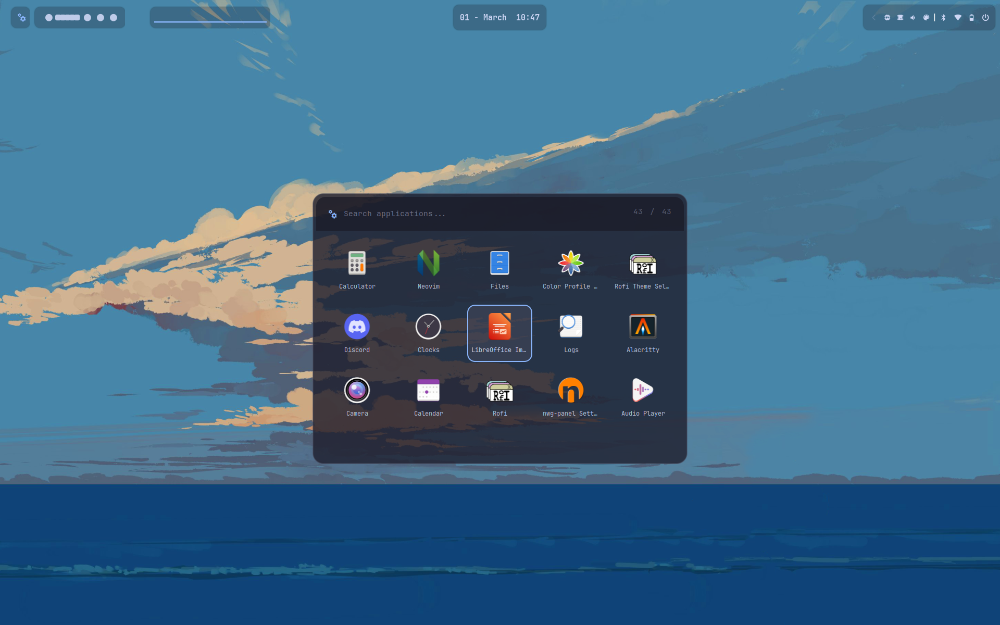</td>
  </tr>
  <tr>
    <td>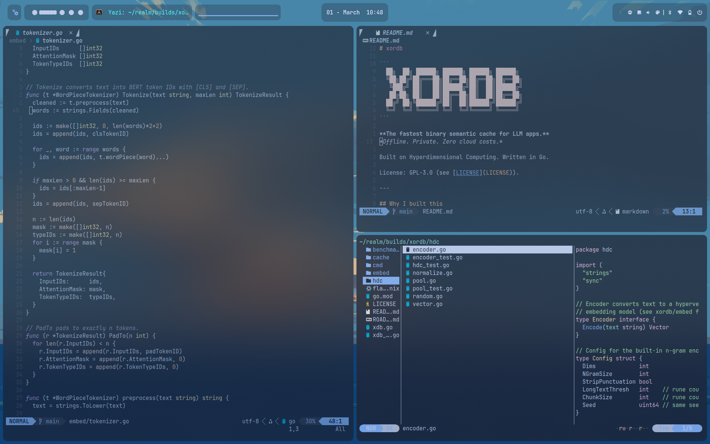</td>
    <td></td>
    <td></td>
  </tr>
</table>

## Quick Start (New Machine)

```bash
# Clone the repo
mkdir -p ~/realm/builds && cd ~/realm/builds
git clone <your-repo-url> dotfiles
cd dotfiles

# Install everything
./install.sh deps      # Install all dependencies (requires sudo)
./install.sh install   # Install dotfiles

# Set zsh as default shell
chsh -s $(which zsh)

# Log out and log back in, then select Hyprland at login screen
```

## Commands

```bash
./install.sh deps              # Install system dependencies
./install.sh install           # Install dotfiles (default: gruvbox theme)
./install.sh install --monochrome      # Install with monochrome theme
./install.sh install --catppuccin-mocha # Install with catppuccin theme
./install.sh uninstall         # Remove dotfiles
./install.sh restow            # Reinstall (useful after pulling updates)
```

## What Gets Installed

### `./install.sh deps` installs:

**Hyprland & Wayland:**
- hyprland, waybar, mako, rofi, hyprpaper, hyprlock, hypridle, hyprpolkitagent
- xdg-desktop-portal-hyprland, xdg-desktop-portal-gtk, cliphist, wl-clipboard

**Apps:**
- alacritty, neovim, tmux, lazygit, cava, yazi, nautilus

**Zsh:**
- zsh, oh-my-zsh, starship
- zsh-autosuggestions, zsh-syntax-highlighting, zsh-history-substring-search
- fzf, zoxide

**Utils:**
- grim, slurp (screenshots), pamixer, brightnessctl, playerctl
- pipewire, pavucontrol, blueman

**Dev tools:**
- git, stow, gcc, make, cmake, nodejs, npm, python3

**Fonts:**
- google-noto-fonts, jetbrains-mono-fonts, rsms-inter-fonts, JetBrainsMono Nerd Font, VT323

### `./install.sh install` configures:

| Package | Description |
|---------|-------------|
| `alacritty-stow` | Terminal emulator |
| `cava-stow` | Audio visualizer |
| `fontconfig-stow` | Font rendering |
| `gtk3-stow` | GTK3 theme settings |
| `gtk4-stow` | GTK4 theme settings |
| `hypr-stow` | Hyprland, hyprpaper, hyprlock, hypridle |
| `mako-stow` | Notification daemon |
| `nvim-stow` | Neovim config |
| `rofi-stow` | App launcher |
| `tmux-stow` | Terminal multiplexer |
| `waybar-stow` | Status bar |
| `zsh-stow` | `~/.zshenv` (sets `ZDOTDIR`), zsh config, aliases |

## Themes

Available themes: `gruvbox` (default), `monochrome`, `catppuccin-mocha`, `bsod`, `platinum`

Switch themes:
```bash
./install.sh restow --monochrome
./install.sh restow --catppuccin-mocha
./install.sh restow --gruvbox
```

Reload after switching:
```bash
hyprctl reload
killall waybar && waybar &
makoctl reload
exec zsh
```

### Waybar layouts

Colour themes and bar layouts are independent. A layout lives in
`waybar-stow/.config/waybar/configs/<name>/` (`config` + `style.css`); the
active one is tracked by the `configs/current` symlink and the generated
`style.css` is `themes/current.css` + the layout's `style.css`.

Available layouts: `default`, `bsod`, `platinum` (tied to the themes of the same
name), plus two ports of [swaystation](https://github.com/el-toro-fuerte96/swaystation)'s
bars: `outline` and `floating`.

### Appearance switcher

`Super + Shift + T` opens a full-size rofi card grid with three tabs (Ctrl+Tab or
click to switch): **Themes** (palette preview cards), **Bar** (layout sketches)
and **Wallpapers** (large thumbnails, plus a Random card). The current item is
highlighted. Picking a card applies it immediately and the window stays open so
you can keep browsing.

```bash
~/.config/waybar/scripts/appearance-switcher.sh            # Themes tab (Super + Shift + T)
~/.config/waybar/scripts/appearance-switcher.sh layouts    # Bar tab    (Super + Shift + B)
~/.config/waybar/scripts/appearance-switcher.sh walls      # Wallpapers (Super + Shift + W)
~/.config/waybar/scripts/appearance-switcher.sh --gen      # rebuild preview cards only
```

Preview cards are rendered with ImageMagick into `~/.cache/appearance-switcher/`
on first launch (a few seconds) and refreshed when a theme or wallpaper changes.
The grid style lives in `rofi-stow/.config/rofi/appearance.rasi`.

Switch layouts from a terminal:
```bash
~/.config/waybar/scripts/waybar-layout.sh floating
~/.config/waybar/scripts/waybar-layout.sh --list
~/.config/waybar/scripts/waybar-layout.sh --current
```

Switching a colour theme picks the layout named after it if one exists, keeps a
standalone layout (`outline`, `floating`) if that is active, and otherwise falls back
to `default`.

## Key Bindings (Hyprland)

| Shortcut | Action |
|----------|--------|
| `Super + Return` | Terminal (alacritty) |
| `Super + Space` | App launcher (rofi) |
| `Super + Q` | Close window |
| `Super + M` | Exit Hyprland |
| `Super + E` | File manager |
| `Super + V` | Toggle floating |
| `Super + F` | Fullscreen |
| `Super + 1-9` | Switch workspace |
| `Super + Shift + 1-9` | Move window to workspace |
| `Super + H/J/K/L` | Move focus (vim keys) |
| `Super + Shift + H/J/K/L` | Move window |
| `Super + Shift + T` | Appearance switcher (Themes tab) |
| `Super + Shift + B` | Appearance switcher (Bar layout tab) |
| `Super + Shift + W` | Appearance switcher (Wallpapers tab) |
| `Super + Alt + L` | Lock screen (hyprlock) |
| `Print` | Screenshot (full, saved + clipboard) |
| `Super + Print` | Screenshot (region, saved + clipboard) |

## Zsh Aliases

```bash
ll          # ls -lah
lg          # lazygit
tm          # tmux
tma         # tmux attach
tmn <name>  # tmux new -s <name>
j <dir>     # zoxide jump
godmode     # Custom tmux layout
please      # sudo last command
y           # yazi, cd to the dir you quit in
```

### How zsh is wired

`zsh-stow` stows `~/.zshenv`, which sets `ZDOTDIR=~/.config/zsh`, so zsh loads the
repo's `~/.config/zsh/.zshrc` and never reads `~/.zshrc`. `install.sh` moves any
existing `~/.zshrc` to `~/.zshrc.pre-dotfiles`.

Machine-specific config and secrets (API tokens, one-off aliases) go in
`~/.zshrc.local` (mode 600, created empty by `install.sh`, sourced last). Never put
them in the repo.

nvm and conda are lazy-loaded: the default node and the conda base env are on
`PATH` immediately, the tools themselves load on first `nvm` / `conda` call.

### Idle and lock

`hypridle` (started by Hyprland) dims the screen at 4 min, locks at 5, turns the
screen off at 10 and suspends at 30. Lock manually with `Super + Alt + L` or the
power menu. Config: `hypr-stow/.config/hypr/hypridle.conf`.

## Troubleshooting

### Hyprland not in login menu
```bash
mkdir -p ~/.local/share/wayland-sessions
cat > ~/.local/share/wayland-sessions/hyprland.desktop << 'EOF'
[Desktop Entry]
Name=Hyprland
Comment=Hyprland Wayland compositor
Exec=/usr/bin/Hyprland
Type=Application
DesktopNames=Hyprland
EOF
```

### Waybar not starting
```bash
chmod +x ~/.config/waybar/scripts/*.sh
waybar &
```

### Fonts not showing icons
```bash
# Install a Nerd Font manually
# Download from: https://www.nerdfonts.com/font-downloads
mkdir -p ~/.local/share/fonts
# Extract font files to ~/.local/share/fonts/
fc-cache -fv
```

### Starship prompt not showing
```bash
# Install starship (deps does this)
curl -sS https://starship.rs/install.sh | sh
# Make sure ZDOTDIR is set: should print /home/<you>/.config/zsh
zsh -c 'echo $ZDOTDIR'
```

### Zsh aliases not working
```bash
# Re-stow so ~/.zshenv exists, then open a new shell
./install.sh restow
exec zsh
```

### Fix hardcoded paths (if cloned from someone else)
```bash
# Update paths from old user to current user
find . -type f -exec sed -i "s|/home/olduser|$HOME|g" {} \;
./install.sh restow
```

## Manual Package Install

If you prefer to install packages individually:
```bash
cd ~/realm/builds/dotfiles
stow -t ~ alacritty-stow
stow -t ~ hypr-stow
# etc...
```

## Structure

```
dotfiles/
├── install.sh           # Main installation script
├── README.md
├── wallpapers/          # Wallpaper images
│   └── current -> ...   # Symlink to active wallpaper (gitignored)
├── alacritty-stow/
│   └── .config/alacritty/
├── hypr-stow/
│   └── .config/hypr/
│       ├── hyprland.conf
│       ├── hypridle.conf
│       ├── hyprlock.conf
│       ├── keybinds.conf
│       ├── windowrules.conf
│       └── themes/
├── zsh-stow/
│   ├── .zshenv          # sets ZDOTDIR
│   └── .config/zsh/
└── ... (other *-stow packages)

Generated files (`waybar/config`, `waybar/style.css`, `gtk-*/gtk.css`,
`rofi/theme-overrides.rasi`, `zsh/dotfiles-theme.env`, `gtk-3.0/bookmarks`,
`gtk-*/settings.ini`) are
written by `install.sh` / the switcher scripts and are gitignored.
```

## Requirements

- Fedora 43+ (or any distro with Hyprland support)
- GNU Stow
- sudo access for dependency installation
